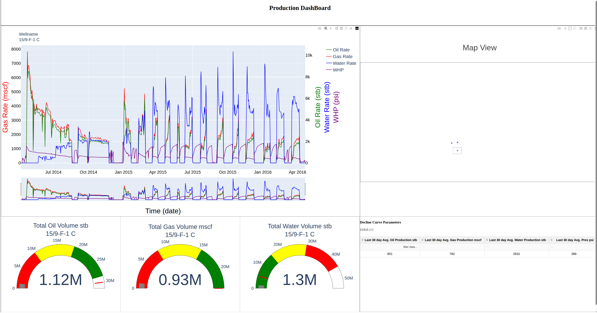

# Volve Field | Production Analytics & Virtual Flow Meter

Two complementary data science projects using the publicly released Equinor Volve field dataset: an interactive production analytics application and a machine-learning virtual flow meter.

## 📊 1. Production Analytics Dashboard

[🚀 Live Application](https://volve-project-vis1.onrender.com/) | [📂 Project Documentation](1_Visualization/README.md)

An interactive Python and Plotly Dash application for reservoir and production engineers to explore well performance, compare production trends, and forecast future production.

**Key capabilities:**
- **Production surveillance:** Visualize well locations, production rates, and cumulative volumes.
- **Well comparison:** Compare oil, gas, and water production across multiple wells alongside reservoir properties.
- **Decline-curve analysis:** Fit exponential, hyperbolic, and harmonic decline models to forecast production and estimate ultimate recovery (EUR).

**Technologies:** Python, Plotly Dash, pandas, NumPy, Flask, Render.

**Status:** Deployed web application.

---

## 🤖 2. Machine Learning Virtual Flow Meter

[📂 Project Documentation & Results](2_Virtual_Meter/README.md)

A machine-learning time-series project investigating how to estimate daily oil, gas, and water production using historical production and operating measurements such as pressure, temperature, choke settings, and on-stream hours.

The objective is to provide reliable phase-rate estimates between physical separator tests, supporting production surveillance and allocation.

**Key capabilities:**
- Developed leakage-aware time-series feature engineering and model evaluation pipelines.
- Evaluated Lasso, Ridge, Elastic Net, Random Forest, Gradient Boosting, and LightGBM.
- Compared recursive and direct forecasting over 7-, 14-, and 30-day prediction horizons.
- Investigated forecasting reliability under changing production and operating conditions.

**Example results — Well 15/9-F-1C, 30-day test forecast:**

| Phase | Model | Test R² |
|---|---|---:|
| Oil | Gradient Boosting | 0.849 |
| Gas | Gradient Boosting | 0.871 |
| Water | LightGBM | -1.045 |

**Key finding:** Strong oil and gas forecasting performance was achievable for a relatively stable well, while water production and abrupt operating-regime changes remained challenging.

**Technologies:** Python, scikit-learn, LightGBM, pandas, NumPy, JupyterLab.

**Status:** Research and model validation; not deployed as a live application.

---

## 📁 Repository Structure

- [0_Volve_dataset](0_Volve_dataset/) — Field data and processed inputs
- [1_Visualization](1_Visualization/) — Production analytics dashboard
- [2_Virtual_Meter](2_Virtual_Meter/) — Machine-learning forecasting models and experiments

Each project folder contains more detailed documentation, methodology, and results.

**Data source:** Equinor Volve field open dataset.

